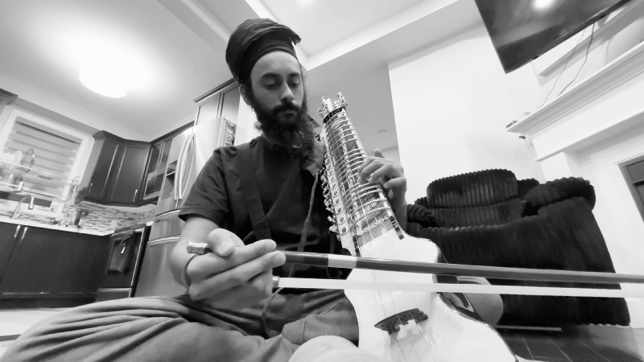

### Learning
- [Deep learning](deep-learning) and neural networks

### Music
- Learning basic Jori bols from Mehar Singh (disciple of Sukhwinder Singh Pinky)
- Practicing sargams on a new Dilruba 👇🏼️

### Work
#### Building Ontario Procurement in our database pipeline from scratch.
- Phase 1 - daily and historical crawler
- Phase 2 - parsing and cleaning of data
- Phase 3 - full historical run
- Phase 4 - production

Challenges:
429s after continuous requests.