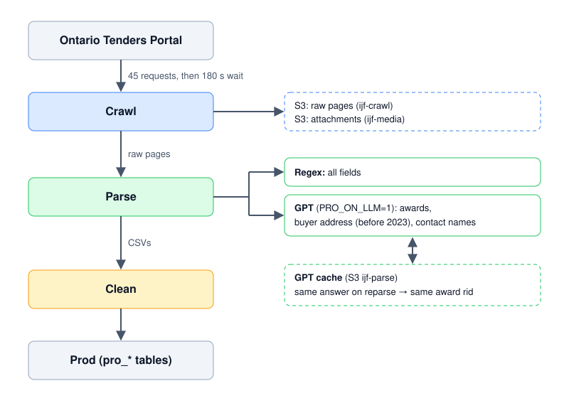
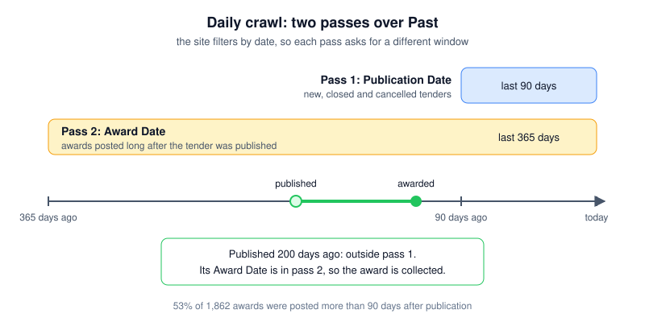
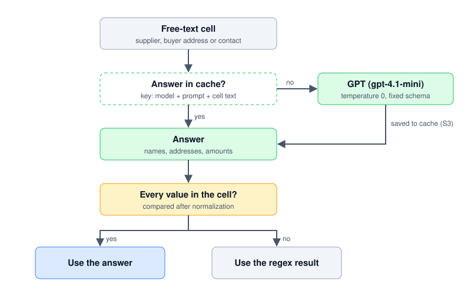
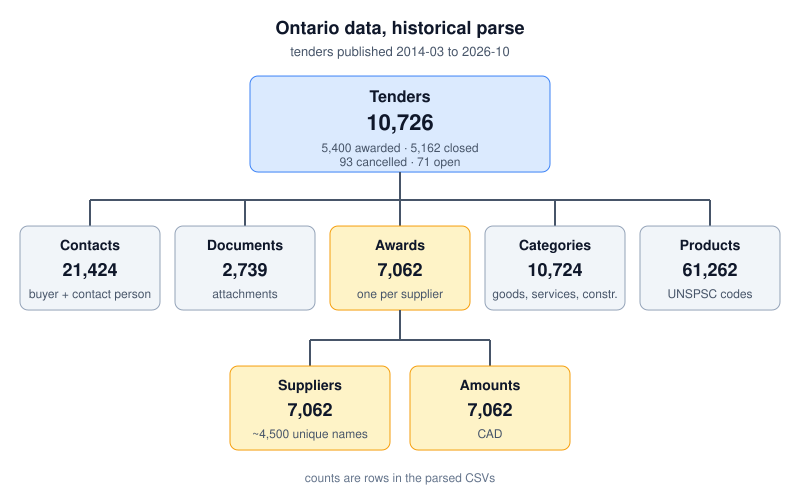

## The gap

At the [Investigative Journalism Foundation (IJF)](https://theijf.org), we collect public procurement data: who the government buys from, what it buys, and for how much. Journalists use it for reporting, and the public can explore it. The team had already built a pipeline that crawls, parses and cleans procurement records from British Columbia, Vancouver and the federal government into one set of tables.

Ontario was the largest province we didn't cover. I took it on as the sole engineer for the source, from July to November 2026, working inside the crawl → parse → clean framework the team had built. The framework, the other provinces, and the Lambda that extracts text from documents are their work. Everything specific to Ontario — the research, the crawler, the parser, the field mapping and the data decisions — is mine.

The first thing I checked was whether Ontario publishes this as open data. It doesn't, not for tenders and awards. What it has is the Ontario Tenders Portal: about 10,500 opportunities since March 2014, each one a set of HTML pages. So the job was to read a website reliably for a decade of history and every day after.

## Reading the site before writing code

I spent the first days probing the portal rather than writing a crawler. A few findings shaped everything that came after.

**It needs a session, but no login.** There's no Cloudflare and no CAPTCHA, so plain HTTP with aiohttp is enough. But a request without a primed session fails. Priming takes two GETs: the login page, then the public "Current Opportunities" link, whose redirect sets the session cookie. A non-browser User-Agent is redirected to a "browser not supported" page. Sessions also expire mid-crawl (I saw it at page 22 of 105), so the fetcher detects the "session is invalid or expired" page, primes a new session and retries once.

**The pager has one cursor per session.** The Past archive is about 105 pages of 100 rows, read through a POST that moves a server-side cursor and a GET that returns the page. Because the cursor belongs to the session, pages have to be fetched one at a time and in order. That rules out the framework's usual parallel workers for this source.

**The rate limit counts requests, not speed.** I measured it instead of guessing. Unthrottled, the site returned HTTP 429 after about 120 requests. At one request per second, it was after about 106. Going slower didn't buy more requests, so the limit is a count per time window. I then tested batches of 45 requests followed by a pause:

| Pause after 45 requests | Result |
|---|---|
| 300 s | passed |
| 180 s | passed |
| 120 s | 429, then a 900 s lockout |

Requests sent during a lockout stretched it to 1,799 s. I settled on 45 requests per 180 s, about 14 a minute, and chose not to rotate sessions to get around the limit. A full history at that rate is about 10,900 requests, roughly 13 hours. That's slow, but it's a one-time cost, and it doesn't push against a public service.

**The site ignores a filter it can't read.** The Past list can be filtered by Publication Date. When I sent a date in the wrong format, the site didn't return an error. It returned all 10,631 rows. A daily crawl that silently became a full crawl would cost 13 hours and nobody would notice. So the crawler now checks every Past row against the filter it asked for, and stops with an error if a row falls outside it.

## Studying the data before parsing it

Before writing a parser, I crawled a sample and studied it: 25 runs, deduplicated to 3,208 unique opportunities from 2014 to 2026. Claude Opus helped me with this initial research and with measuring what came out of it.

The pages weren't one format. I counted 10 page templates. They seemed to follow how each buyer had set up their portal, more than the year. Awards came in 3 shapes. In 284 older pages from 2014–15, the award amount and contract dates were written inside the supplier text, not in their own fields.

The supplier cell was the hardest part. The tidy format `Name; street; City, PROV; Postal` matched only 22 of 1,600 pages. Others listed several suppliers in one cell as numbered lists, address blocks or paragraphs, and 120 pages just said some form of "Multiple Vendors – See Attached".

There was also no status column. "Tender Status" exists only on pages from 2023 on, and only as an exception flag. Before that, "no award" is free text in the supplier cell. I wrote a five-step rule that derives OPEN, CLOSED, AWARDED or CANCELLED from the page, and the crawler and the parser both call the same function, so they always agree.

The requirements were the non-technical challenge. There was no spec for how Ontario's fields should map onto our tables, and some questions took a long time to get answered. I wrote the field mapping myself and recorded each judgment call as a numbered decision. For example: Consulting counts as a service; "See Attached" becomes one award with the supplier "No name given"; an Award Value of 0 or 1 is a placeholder, not an amount. Writing them down meant that when something looked wrong later, I could tell a bug from a decision.

## The design

*The crawler reads the portal and stores raw pages and attachments in S3. The parser uses regex for every field, and GPT for three kinds of free-text cell, with its answers cached in S3. The clean step loads the result into the shared `pro_*` tables in prod.*

A few decisions are worth explaining.

**Dedup at crawl time.** Before a run, the crawler asks prod for the latest status and version date of every Ontario tender. A row that is already AWARDED or CANCELLED is skipped at the list, because those statuses don't change. A detail page with the same version date and status as prod isn't stored again. That keeps a daily run to about 150–250 requests.

**Two passes, because awards are late.** My first plan was to crawl what was published in the last 90 days. Then I measured when awards appear. Across 1,862 awards, 53% were posted more than 90 days after the tender was published. A 90-day window would miss most of them. So the daily crawl makes a second pass filtered by Award Date over the last 365 days, and skips anything the first pass already collected.

*Pass 1 finds new and changed tenders by Publication Date. Pass 2 finds awards by Award Date, which catches a tender published 200 days ago whose award was posted recently.*

**Attachments come from the crawler.** I first assumed document links needed a login, and planned to leave downloads to the team's document Lambda, as other sources do. Testing proved that wrong: the links work without a login, but only inside a primed session, and a bare session cookie gets a 401. The Lambda has no session, so the crawler downloads the files itself and puts them in S3.

**One parser for all years, with a strict mode.** Old pages have old formats, and those are handled in a separate `legacy.py`. But a page first published from 2023 must match the current format. If it doesn't, the parse of that page fails loudly. An unknown format from 2023 on means the site changed, and I'd rather find out than store something half-parsed.

## What broke

After the first full clean, I audited the cleaned data against the raw pages. The supplier splitter was reading contract-date lines, lot headers and note lines as suppliers, and rural addresses like "Lot 12 Con 1" as lot headers. I fixed those, then re-ran the audit: 69 of the 73 changed pages were now correct, and none that had been right before broke.

The first attachment size cap was 50 MB. During the historical crawl, 11 files were skipped for size. I raised the cap to 250 MB and fetched them.

## Regex where it works, an LLM where it doesn't

Even after the fixes, regex was chasing a long tail. My best splitter got the supplier count right on 108 of 115 hand-labelled cells (94%). Each remaining case was a new format, and each rule I added risked breaking another. Buyer addresses before 2023 were often one blob in a single "Street Address" field. Contact name cells mixed names, job titles, emails and phone numbers.

So I used an LLM for exactly three things: award supplier cells (with the Award Value), buyer addresses before 2023, and contact name cells that contain more than a name. Everything else stays on regex.

My main concern was trust. This is data for journalism, and a model that invents a supplier or an amount is worse than one that returns nothing. So every answer goes through a check: each name, street, city, postal code and amount in the answer must appear in the original cell, after normalizing case, spaces and punctuation. If anything doesn't, the parser throws the answer away and uses its regex result.

*Each free-text cell is looked up in the cache first. On a miss, GPT answers with temperature 0 and a fixed schema, and the answer is saved. An answer is used only if every value in it appears in the cell; otherwise the regex result is used.*

The check earned its place. On one 2021 tender, the model divided a total among several suppliers on its own. That split wasn't in the cell, so the check rejected it.

The second concern was stability. An award's ID is a hash of the tender number, the supplier name and the award date. If a re-parse returned a slightly different name, prod would get a duplicate award. So every answer is cached by a hash of the model, the prompt and the cell text, in S3, since the prod job has no disk that persists between runs. If S3 fails with anything other than "not found", the parse stops instead of asking the model again.

I started with gpt-4o and compared it with regex on held-out samples. I then moved to gpt-4.1-mini because it cost less and the tests showed the same quality. Claude Opus helped me measure and test the output. "Changed" below means different from regex, and I reviewed the changes by hand:

| Sample | Model | Records | Awards changed | Contacts changed | Errors |
|---|---|---|---|---|---|
| 2019 | gpt-4o | 50 | 10 | 18 | 0 |
| 2024 | gpt-4o | 50 | 23 | 0 | 0 |
| 2020 | gpt-4.1-mini | 100 | 41 | 52 | 0 |
| 2021 (held out) | gpt-4.1-mini | 100 | 47 | 44 | 0 |

Typical changes: regex kept "467 Beach Boulevard / Hamilton, ON / L8H 6W8" as one street; the LLM split it into street, city, province and postal code. "Faye Collins, Senior Procurement Consultant" became the name "Faye Collins". The 2021 sample of 100 records took 107 calls, about 64,000 input tokens and 6,000 output tokens.

## Loading ten years

The historical parse took about 2 hours 26 minutes. Nearly all of it was waiting on about 6,700 LLM calls, made one at a time. With the cache filled, a re-parse only reads local files.

To replace the earlier regex-only data, I deleted the Ontario award and contact rows in prod and kept the documents. A document's version ID is rebuilt from the same fields on every parse, so the documents didn't need to be reloaded.

One more decision came up here: when an award has several suppliers but only one total, which supplier gets the amount? I checked how our British Columbia and federal data handle it. They repeat the total on each supplier, so Ontario now does the same, and keeps per-supplier amounts when the cell gives them.

*Rows in the historical parse: tenders published from March 2014 to October 2026, and the tables that hang off them.*

The result is 10,726 tenders and 7,062 awards from 5,400 awarded tenders, with 21,424 contacts, 2,739 documents and 61,262 product codes. No award or contact points to a missing tender, and there are no duplicate award IDs. The earlier regex-only load had 6,927 awards; the difference is cells with several suppliers that are now split. One gap comes from the source, not the parser: only 37% of tenders before 2023 have a buyer city, against 95% from 2023 on, because 3,751 older pages have no address field at all.

## Where it stands

The daily run is live in production. Turning the LLM on in that daily job is planned; the historical data was parsed with it. The data is loaded but hasn't been used in a story or product yet, so I can't claim impact beyond that.

## What I'd do differently

**Sample randomly.** My data study used the first page of results from each year. It found the formats, but a random sample would have given fairer counts, and I'd have trusted the percentages more.

**Bring in the LLM earlier.** I spent a lot of time tuning regex for supplier cells before admitting the tail was too long. The check-against-the-cell design would have let me use a model safely from the start, and spend the regex effort where formats are actually fixed.

## Closing

The parts of this I'm proudest of aren't the code. They're the measurements that came before it: counting requests until the rate limit showed its shape, noticing that a bad filter returned everything instead of failing, and finding that more than half the awards arrive after a 90-day window would have closed. Each one changed the design. The LLM followed the same rule: use it where the problem is open-ended, check every answer against the source, and make sure a second run gives the same IDs as the first.
